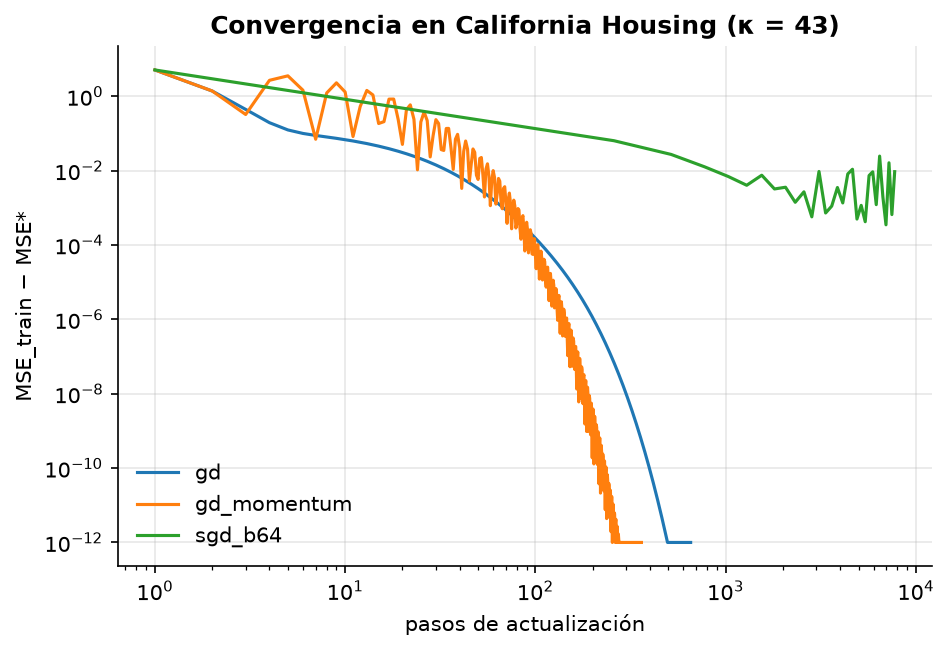

# Mini-proyecto: regresión lineal y descenso de gradiente desde cero

**Pregunta:** ¿qué tan cerca llegan GD, GD con momentum y SGD por minilotes, implementados
en NumPy, a la solución de mínimos cuadrados exacta? ¿De qué depende la velocidad?

**Datos:** California Housing (censo de EE. UU. 1990, 20 640 distritos, 8 features, objetivo =
valor mediano de vivienda en cientos de miles de USD). Split 80/20 con semilla fija;
estandarización con estadísticos de *train*.

## Ejecutar

```bash
uv run python 01-semestre-1/01-matematicas-aplicadas/data/download.py
uv run python 01-semestre-1/01-matematicas-aplicadas/proyecto/run.py
```

Salidas en [`resultados/`](resultados/): `metrics.json`, `convergencia.png`, `coeficientes.png`.

## Resultados (test)

κ de la Hessiana = 42.9; tasa para GD η = 1/L = 0.2475.

| Modelo | RMSE | R² | Iteraciones/épocas |
|---|---|---|---|
| `normal_eq` | 0.7315 | 0.5879 | — |
| `sklearn` | 0.7315 | 0.5879 | — |
| `gd` | 0.7315 | 0.5879 | 654 |
| `gd_momentum` | 0.7315 | 0.5879 | 360 |
| `sgd_b64` | 0.7599 | 0.5552 | 30 |



## Lectura

- **GD y momentum alcanzan la forma cerrada** (diferencia máxima en coeficientes < 1e-7).
  El η no se eligió a ojo: se derivó de la curvatura máxima de la pérdida (η = 1/L).
- **Momentum (β = 0.9) reduce las iteraciones ~45 %**, pero oscila: con κ ≈ 43 el β óptimo
  teórico de heavy-ball (con su η óptimo asociado, no con η = 1/L) es $((\sqrt\kappa-1)/(\sqrt\kappa+1))^2 \approx 0.54$; 0.9 es demasiado.
- **SGD con η constante se estanca** en una bola de ruido alrededor del óptimo (≈ 1e-2 sobre
  MSE*), y su R² en test queda ~3 puntos por debajo. Corregirlo exige η decreciente
  (p. ej. $\eta_t = \eta_0/(1 + t/\tau)$) o promediar iterados (Polyak-Ruppert).
- **El techo es el modelo, no el optimizador:** R² ≈ 0.59 con un modelo lineal. Las relaciones
  de ubicación (lat/long) y la censura del objetivo en 5.0 no son lineales; eso se retoma en
  Aprendizaje automático.

## Extensiones propuestas

1. Implementar el schedule de η decreciente y repetir la comparación de SGD.
2. Probar β ∈ {0.3, 0.54, 0.7, 0.9} y verificar empíricamente el óptimo teórico.
3. Agregar Ridge (ejercicio 1) y graficar el camino de regularización de los coeficientes.
