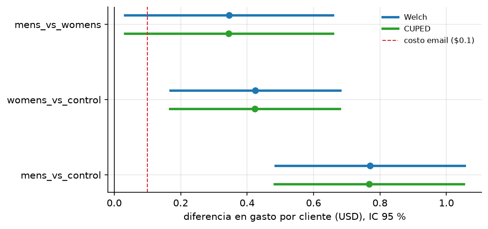
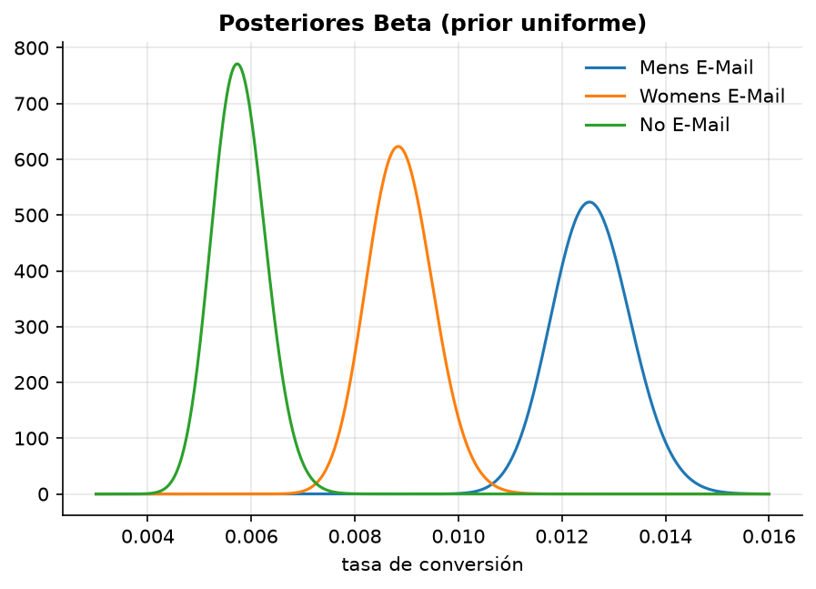
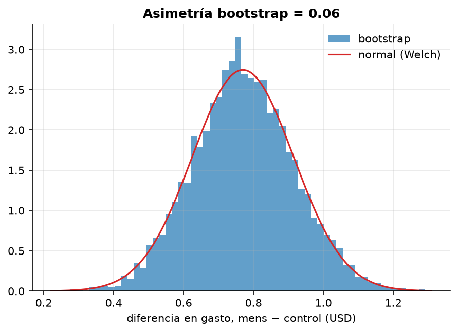

# Mini-proyecto: A/B/C test de email (Hillstrom, MineThatData 2008)

**Pregunta:** ¿qué campaña de email conviene enviar —la de mercancía de hombre, la de mujer o
ninguna— y con cuánta seguridad?

**Datos:** 64 000 clientes que compraron en los últimos 12 meses, asignados **al azar** a tres
grupos de ~21 300: email de hombre, email de mujer, sin email (control). Resultados medidos en
las 2 semanas siguientes: visita al sitio, conversión y gasto (USD).

## Ejecutar

```bash
uv run python 01-semestre-1/02-estadistica-aplicada/data/download.py
uv run python 01-semestre-1/02-estadistica-aplicada/proyecto/run.py   # ~8 s
```

Salidas en [`resultados/`](resultados/): `metrics.json` y tres figuras.

## Plan de análisis (fijado antes de ver resultados)

| Paso | Qué | Por qué |
|---|---|---|
| 1. Validez | SRM (χ²) y balance de covariables (SMD) | si la aleatorización falló, nada de lo demás vale |
| 2. Principal | Gasto por cliente, 3 comparaciones, Holm | es la métrica de negocio; Holm controla FWER en la familia |
| 3. Robustez | Welch, bootstrap, permutación, CUPED | el gasto es 99 % ceros + cola pesada: no confiar en un solo método |
| 4. Secundarias | Visita y conversión: z + Beta–Binomial, BH | explican *por qué* cambia el gasto |
| 5. Exploratorio | Efecto por historial de compra (hombre/mujer/ambos) | genera hipótesis, no las confirma |

## Resultados

**Validez.** SRM: χ² = 0.20, p = 0.90 (tamaños consistentes con 1/3 cada uno).
Balance: max |SMD| = 0.009 en recency, history, mens, womens, newbie. La aleatorización se ve sana.

**Gasto por cliente (control: $0.653).**

| Comparación | Δ USD | IC 95 % Welch | IC 95 % bootstrap | p (Holm) | p permutación |
|---|---|---|---|---|---|
| hombre − control | **+0.770** | (0.485, 1.055) | (0.496, 1.058) | 3.5e-07 | ≤ 2e-4 * |
| mujer − control | **+0.424** | (0.169, 0.680) | (0.171, 0.681) | 2.3e-03 | 1.4e-03 |
| hombre − mujer | **+0.345** | (0.033, 0.658) | (0.030, 0.668) | 0.030 | 0.031 |

\* Con 5000 permutaciones el p mínimo representable es 1/5001.



**Secundarias.** Visita: 10.6 % (control) → 15.1 % (mujer) → 18.3 % (hombre).
Conversión: 0.57 % → 0.88 % → 1.25 %. Todas las diferencias con p_BH < 3e-4 y P(B > A) > 0.999.
El email de hombre **duplica** la conversión.



## Lectura

- **Ambos emails funcionan; el de hombre gana a todo nivel** (visita, conversión, gasto), y la
  diferencia hombre − mujer sobrevive a Holm, aunque su IC roza el cero.
- **Los cuatro métodos coinciden.** Con ~21 000 por grupo el TLC ya actúa sobre la media del gasto
  pese a su asimetría (compárese con la figura de cobertura del notebook 01, donde con n = 3000
  aún no alcanzaba). El bootstrap confirma que la distribución de Δ es casi normal:
  
- **CUPED no ayudó (reducción de varianza ≈ 0 %), y está bien que así sea.** Su ganancia es
  $\rho^2$ y aquí $\rho(\text{gasto}, \text{history}) = 0.022$; ni todas las covariables juntas
  explican más que $R^2 = 0.0009$ del gasto. Un gasto anual agregado no predice si alguien
  compra en dos semanas concretas. CUPED rinde con la **misma métrica en un período previo**
  (ejercicio 5).
- **Exploratorio (por historial de compra):** el email de hombre sube el gasto en los tres
  segmentos, incluso en clientes que solo compraron mercancía de mujer (+0.62, p_BH = 0.001),
  y su mayor efecto está en quienes compraron ambas (+1.83). El email de mujer no muestra efecto
  claro en clientes solo-hombre (p_BH = 0.21) ni en ambos (p_BH = 0.75). Son 6 pruebas no
  preregistradas: hipótesis para un próximo experimento, no conclusiones.

## Decisión

Pendiente: depende de `choose_campaign()` en `run.py` (regla de decisión con costo por email
supuesto de $0.10). Ver “Extensiones”.

## Extensiones propuestas

1. Implementar `choose_campaign()` y justificar la regla elegida.
2. Estimar el efecto en gasto **condicional a comprar** (¿el email cambia cuánto se gasta o solo
   cuántos compran?). Ojo: condicionar a un resultado post-tratamiento rompe la aleatorización.
3. Repetir el análisis con un modelo de dos partes (hurdle): P(compra) × E[gasto | compra].
