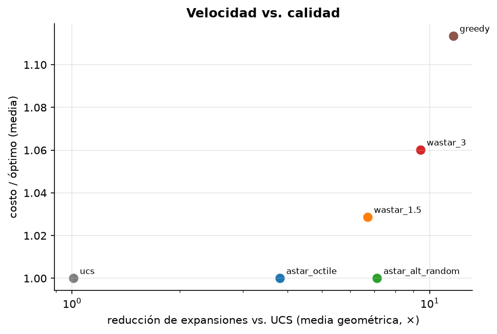
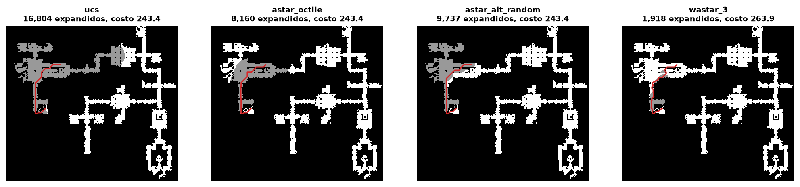

# Mini-proyecto: agente de búsqueda de caminos en mapas de videojuego

**Pregunta:** en mapas reales, ¿cuánto ahorra cada idea de búsqueda informada (heurística
geométrica, heurística con precómputo, pesos) y qué cuesta en calidad de la ruta?

**Datos:** benchmarks de Moving AI Lab (N. Sturtevant, IEEE TCIAIG 2012): mapas de
*Dragon Age: Origins* con escenarios cuya **longitud óptima está publicada**. Cuatro mapas de
estructura distinta:

| Mapa | Tamaño | Estructura |
|---|---|---|
| `den312d` | 65×81 | salas pequeñas |
| `arena2` | 281×209 | espacios abiertos |
| `ost003d` | 194×194 | mixto |
| `brc202d` | 530×481 | grande, pasillos largos |

Muestra estratificada por *bucket* (longitud de ruta): 209 escenarios en total, desde rutas de
pocas casillas hasta de varios cientos.

## Ejecutar

```bash
uv run python 01-semestre-1/03-fundamentos-ia/data/download.py
uv run python 01-semestre-1/03-fundamentos-ia/proyecto/run.py   # ~30 s
```

## Validación

UCS, A* y A*+ALT reproducen la longitud óptima publicada en las **627 ejecuciones**
(209 escenarios × 3 algoritmos óptimos), con tolerancia 1e-6 (los archivos traen 8 decimales).
El script falla si alguna no coincide.

## Resultados

| Algoritmo | Mediana expandidos | Reducción vs. UCS | Costo/óptimo (media) | Peor caso | Segundos totales |
|---|---|---|---|---|---|
| `ucs` | 11,154 | 1.0× | 1.000 | 1.000 | 7.5 |
| `astar_octile` | 4,769 | 3.8× | 1.000 | 1.000 | 5.2 |
| `astar_alt_random` | 1,315 | 7.1× | 1.000 | 1.000 | 2.9 |
| `wastar_1.5` | 2,245 | 6.7× | 1.029 | 1.159 | 3.6 |
| `wastar_3` | 1,234 | 9.4× | 1.060 | 1.378 | 2.5 |
| `greedy` | 880 | 11.6× | 1.113 | 2.011 | 2.0 |

Reducción = media geométrica de (expandidos UCS / expandidos del algoritmo) por escenario.





## Lectura

- **A*+ALT es la mejor opción si se exige optimalidad:** 7.1× menos expansiones que UCS,
  casi el doble que octile, sin perder nada de calidad. Precómputo: < 1 s por mapa (8 Dijkstra).
- **Su ventaja depende de la estructura del mapa.** Reducción vs. UCS por mapa:

  | Mapa | octile | ALT (aleatorio) | WA* 1.5 |
  |---|---|---|---|
  | den312d | 5.2× | 8.4× | 8.9× |
  | arena2 | 5.6× | 6.7× | 11.1× |
  | ost003d | 3.5× | 8.0× | 5.7× |
  | brc202d | 2.4× | 6.1× | 4.0× |

  En espacios abiertos (`arena2`) octile ya es casi exacta y ALT aporta poco; en mapas con
  pasillos (`brc202d`, `ost003d`) octile “no ve” las paredes y ALT las incorpora vía distancias reales.
- **WA* y Greedy cambian calidad por velocidad**, y la cota teórica es holgada: WA* con w = 3
  garantiza ≤ 3× el óptimo, pero en promedio pierde 6 % y en el peor caso 38 %. Greedy llega a
  devolver rutas del **doble** de largo.
- **Landmarks aleatorios son una lotería:** en el escenario de la figura (brc202d), ALT aleatorio
  expande *más* que octile (9,737 vs. 8,160). Un landmark solo ayuda si está “detrás” del inicio o de la
  meta; uno en medio del mapa no da cota útil. Ver extensión 1.

## Dos errores que encontré y corregí al construirlo

1. **Re-expansiones por redondeo.** Con A* y octile (consistente) aparecían cientos de nodos
   re-expandidos por escenario. Causa: sumar √2 en distinto orden da `g` que difieren en ~1e-15, y la
   comparación estricta `g_nuevo < g_viejo` “mejoraba” caminos idénticos. Solución: tolerancia
   `G_TOLERANCE = 1e-9`, con test de regresión.
2. **Reapertura en WA*/Greedy.** Reabrir estados (necesario para A* con heurísticas inconsistentes)
   hacía que Greedy re-expandiera entre el 77 % y el 92 % de sus nodos (medido en escenarios largos)
y tardara 8× más que A*. WA* mantiene su
   cota sin reabrir (Likhachev et al., ARA*, 2003); al desactivarlo, el tiempo total bajó de 104 s a 26 s.

## Extensiones propuestas

1. **Implementar `select_landmarks(strategy="farthest")`** en `src/ai_foundations/landmarks.py`
   (TODO marcado): el proyecto la detecta y la agrega automáticamente a la comparación.
2. Agregar *Jump Point Search*, que explota la simetría de las grillas uniformes.
3. Comparar memoria (frontera máxima) además de expansiones.
