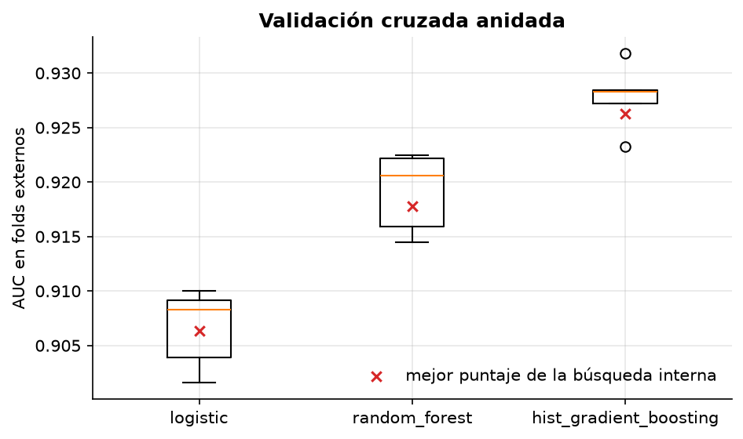
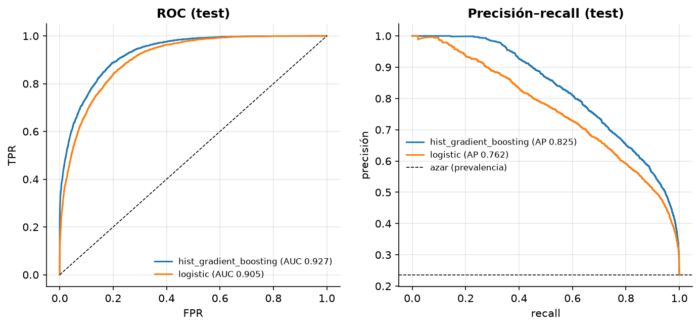
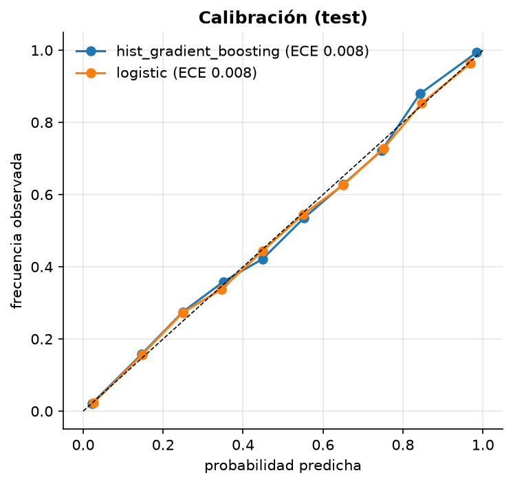
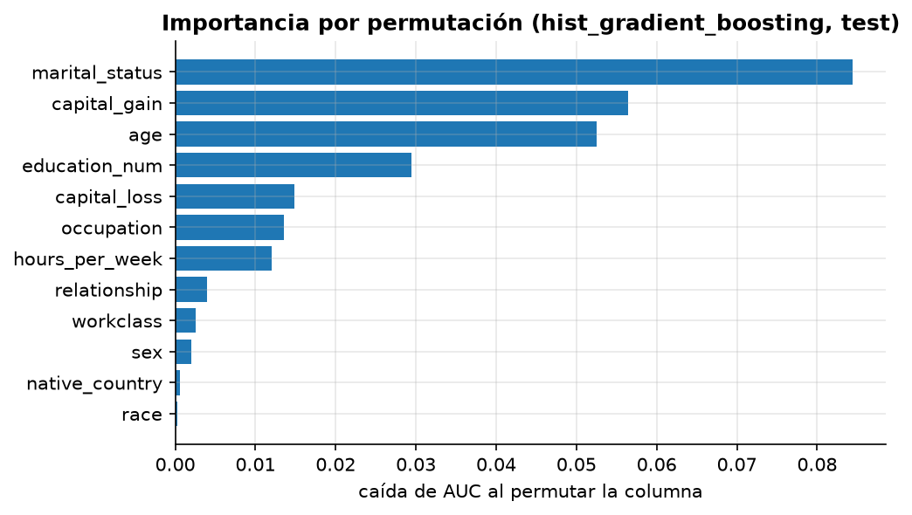

# Mini-proyecto: pipeline completo de clasificación sobre UCI Adult

**Pregunta:** ¿qué tan bien se puede predecir si una persona gana más de 50 000 USD al año a
partir de datos del censo de 1994, y cómo estimarlo sin engañarse?

**Datos:** UCI Adult (Becker & Kohavi), particiones oficiales: 32 561 train / 16 281 test,
24 % de positivos. Licencia CC BY 4.0.

## Ejecutar

```bash
uv run python 01-semestre-1/04-aprendizaje-automatico/data/download.py
uv run python 01-semestre-1/04-aprendizaje-automatico/proyecto/run.py   # ~1.5 min
```

## Decisiones de preparación

| Decisión | Por qué |
|---|---|
| Eliminar `fnlwgt` | Es el peso muestral del censo (cuántas personas representa la fila), no un atributo de la persona |
| Eliminar `education` | Es una recodificación 1 a 1 de `education_num` |
| Imputar y codificar **dentro** del `Pipeline` | Así se ajustan solo con el fold de entrenamiento (ver notebook 01, fugas) |
| `OneHotEncoder(min_frequency=20)` | Agrupa categorías raras (41 países): menos columnas casi vacías, mejor condicionamiento |
| Faltantes categóricos → categoría `"Missing"` | El “?” es informativo: donde falta `occupation` también falta `workclass` (99.6 %), y la tasa de >50K es 10.4 % frente a 24.9 % del resto |

## 1. Selección de modelo: validación cruzada anidada

5 folds externos (estimación) × 3 internos (búsqueda de hiperparámetros), métrica AUC.

| Modelo | AUC externa (media ± desv.) | Mejor puntaje interno | Segundos |
|---|---|---|---|
| `baseline` (prevalencia) | 0.5000 ± 0.0000 | 0.5000 | 4 |
| `logistic` | 0.9066 ± 0.0037 | 0.9064 | 3 |
| `random_forest` | 0.9191 ± 0.0037 | 0.9178 | 26 |
| `hist_gradient_boosting` | **0.9278 ± 0.0031** | 0.9262 | 19 |



Gana gradient boosting, y le gana a random forest **en los 5 folds** (diferencia pareada
0.0087 ± 0.0019): consistente, no ruido. Comparar por fold es lo correcto porque ambos modelos
se evaluaron en las mismas particiones.

## 2. Desde cero vs. scikit-learn

Mismos hiperparámetros, mismo preprocesamiento, mismo split.

| Modelo | AUC sklearn | AUC desde cero | Tiempo sklearn | Tiempo desde cero |
|---|---|---|---|---|
| Logística (C = 1) | 0.90494 | 0.90494 | 0.67 s (L-BFGS) | 0.16 s (Newton) |
| Árbol (prof. 8, hoja ≥ 20) | 0.90491 | 0.90492 | 0.14 s (Cython) | 0.48 s (NumPy) |

La logística propia con descenso de gradiente tardaba 36 s **sin converger**: con one-hot de
categorías raras el problema está mal condicionado. Cambiar a Newton (81 parámetros → un sistema
81×81 por iteración) la resolvió en 7 iteraciones. Ver `src/applied_ml/linear.py`.

## 3. Evaluación final en test (una sola vez)

Modelo: `HistGradientBoostingClassifier(learning_rate=0.1, max_leaf_nodes=31)`, reentrenado con
todo el train.

| Métrica | Valor |
|---|---|
| AUC | **0.9275** (IC 95 % bootstrap: 0.9234–0.9314) |
| Average precision | 0.825 (azar = prevalencia = 0.236) |
| Log-loss / Brier | 0.276 / 0.088 |
| ECE (calibración) | 0.008 |
| Accuracy | 0.866 (“siempre ≤50K”: 0.764) |

El AUC de test cae dentro del rango de la CV anidada (0.9278 ± 0.0031): la estimación fue honesta.

**Umbral.** Elegido maximizando F1 en predicciones *out-of-fold* de train (el test no se usa):
0.40. Frente al 0.5 por defecto, cambia precisión por recall:

| Umbral | Precisión | Recall | F1 |
|---|---|---|---|
| 0.5 | 0.773 | 0.652 | 0.707 |
| 0.40 (OOF) | 0.711 | 0.728 | **0.719** |




## 4. Importancia y subgrupos



`marital_status`, `capital_gain`, `age` y `education_num` dominan. **`sex` aporta casi nada
por permutación (0.002) aunque el ingreso difiere mucho por sexo:** su información ya está en
`relationship` (Husband/Wife) y `marital_status`. Quitar un atributo protegido no quita la
información que lleva.

Métricas por sexo, con el umbral de 0.40:

| Grupo | n | Prevalencia | Tasa predicha + | AUC | TPR | FPR |
|---|---|---|---|---|---|---|
| Female | 5 421 | 0.109 | 0.101 | 0.947 | 0.653 | 0.034 |
| Male | 10 860 | 0.300 | 0.312 | 0.909 | 0.741 | 0.128 |

Con el mismo umbral, el modelo detecta menos a las mujeres que sí ganan >50K (TPR 0.65 frente a
0.74) y se equivoca menos con los hombres que no (FPR 0.034 frente a 0.128). Qué significa esto y
qué hacer al respecto es materia del módulo de **Ética e integridad de datos**, que reutiliza este
modelo (`applied_ml.adult`).

## Lo que no funcionó (y lo que sorprendió)

- **`log1p` en `capital_gain/loss` empeoró la logística** en los 5 folds (AUC 0.907 → 0.900).
  La intuición (“comprimir la cola larga”) era incorrecta: la relación es casi un umbral
  (ganancias grandes ⇒ >50K), y la escala log aplasta justo esos valores. Los modelos de árboles
  dieron exactamente el mismo AUC con y sin `log1p`: son invariantes a transformaciones monótonas.
- **El puntaje interno no resultó optimista** (0.9262 frente a 0.9278 externo). Hay dos sesgos
  opuestos: el optimismo de quedarse con el máximo de varias estimaciones, que aquí es pequeño
  (grillas de ≤ 6 configuraciones, 32 000 filas), y el pesimismo de que la búsqueda interna
  entrene con 2/3 de los datos. Aquí dominó el segundo. Con pocos datos y grillas grandes
  domina el primero: ver notebook 01, sección 4.

## Tu turno

`engineer_features()` en `run.py` está vacía (TODO). Lo que agregues pasa por la misma CV anidada,
así que su efecto es medible contra la tabla de la sección 1. Ideas, con sus trade-offs:

- **Indicadores** como `capital_gain > 0` o `capital_gain == 99999` (tope de censura): ayudan a la
  logística, que no puede aprender umbrales; a los árboles probablemente no les cambien nada.
- **Interacciones** (edad × educación, horas × ocupación): de nuevo, útiles sobre todo para modelos lineales.
- **Agrupar** `native_country` (41 valores) o `marital_status`: menos varianza, posible pérdida de señal.
- Cuidado con features que codifiquen atributos protegidos de forma más directa (ver sección 4).
