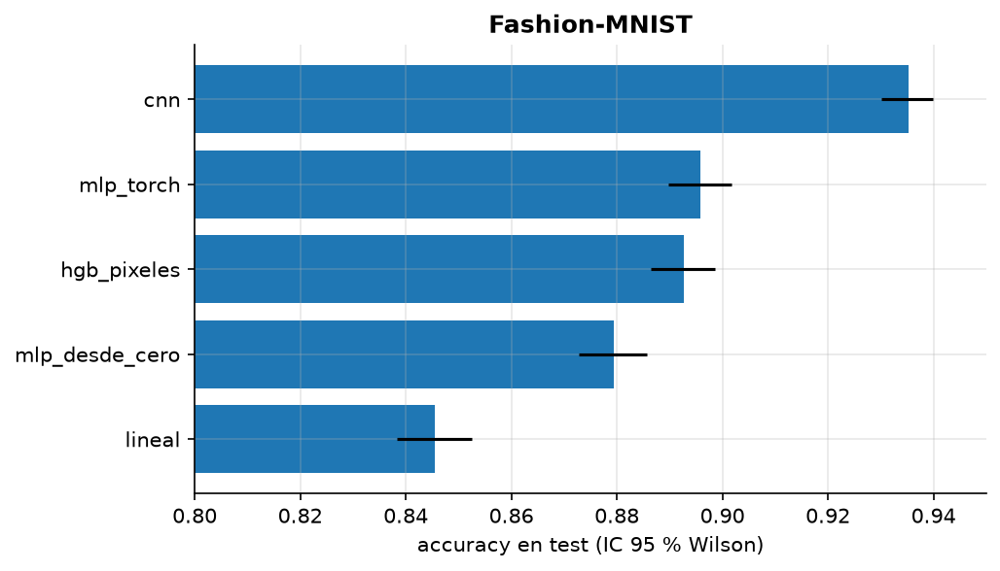
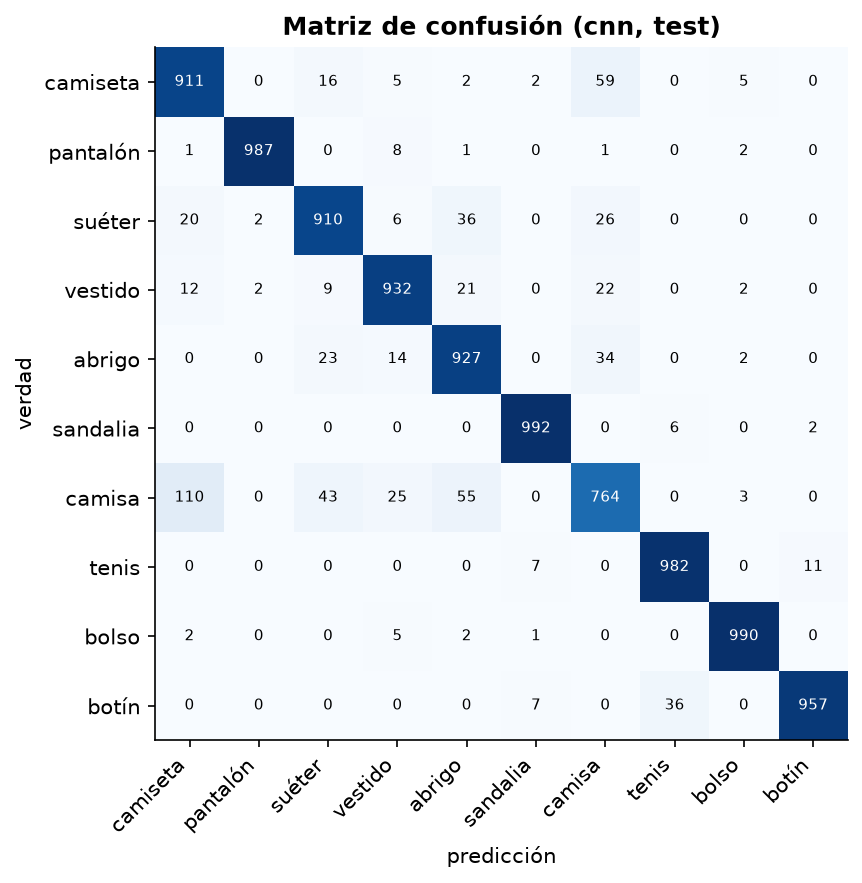
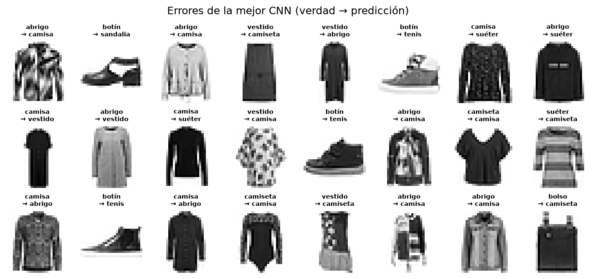

# Mini-proyecto: CNN sobre Fashion-MNIST frente a baselines serios

**Pregunta:** ¿cuánto aporta una red convolucional frente a modelos sin sesgo espacial, incluido
el mejor modelo clásico del módulo anterior, y es esa diferencia estadísticamente clara?

**Datos:** Fashion-MNIST (Xiao, Rasul & Vollgraf, 2017; licencia MIT). 70 000 imágenes 28×28 de
10 tipos de prenda. Split: 55 000 train / 5 000 validación (semilla fija) / 10 000 test oficial.
Normalización con media y desviación del train.

## Ejecutar

```bash
uv sync --extra base --extra dl
uv run python 01-semestre-1/05-aprendizaje-profundo/data/download.py
uv run python 01-semestre-1/05-aprendizaje-profundo/proyecto/run.py   # ~4 min con MPS
```

Los pesos de las CNN se guardan en `resultados/*.pt` (ignorados por git).

## Modelos

| Modelo | Detalle |
|---|---|
| `lineal` | softmax sobre los 784 pixeles |
| `hgb_pixeles` | `HistGradientBoostingClassifier` sobre pixeles: el ganador del módulo 04 |
| `mlp_desde_cero` | 784-256-10 con el autograd propio (`applied_dl`, NumPy float64), Adam, 6 épocas |
| `mlp_torch` | 784-512-256-10, dropout 0.2 |
| `cnn` | 2 bloques [conv3×3-BN-ReLU ×2 → maxpool] (32 y 64 canales) + denso 128, dropout 0.3 |
| `cnn_aumentada` | la misma CNN con aumentación de datos (**tu turno**) |

Modelos de PyTorch: AdamW (lr 1e-3, weight decay 1e-4), coseno sobre la tasa, early stopping
con paciencia 6 sobre la pérdida de validación, restaurando los mejores pesos.

## Resultados (test, 10 000 imágenes)

| Modelo | Accuracy | IC 95 % (Wilson) | Parámetros | Tiempo |
|---|---|---|---|---|
| `lineal` | 0.8455 | 0.838–0.852 | 7 850 | 14 s |
| `mlp_desde_cero` | 0.8794 | 0.873–0.886 | 203 530 | 4 s |
| `hgb_pixeles` | 0.8927 | 0.886–0.899 | — | 58 s |
| `mlp_torch` | 0.8958 | 0.890–0.902 | 535 818 | 30 s |
| **`cnn`** | **0.9352** | 0.930–0.940 | 468 202 | 140 s |



**McNemar (exacta) de la CNN contra cada modelo.** Se cuentan solo los ejemplos donde uno acierta
y el otro no:

| Comparación | Solo la CNN acierta | Solo el otro acierta | p-valor |
|---|---|---|---|
| CNN vs. MLP torch | 575 | 181 | 1.4e-48 |
| CNN vs. HGB | 593 | 168 | 2.3e-56 |
| CNN vs. MLP desde cero | 714 | 156 | 5.9e-86 |
| CNN vs. lineal | 1 045 | 148 | 1.1e-166 |

## Lectura

- **La CNN gana con claridad, y con menos parámetros que el MLP de torch.** La diferencia no es de
  capacidad sino de *sesgo inductivo*: la convolución asume localidad y reutiliza los mismos
  filtros en toda la imagen.
- **Sin estructura espacial, el techo está cerca de 0.89–0.90:** HGB y el MLP de torch quedan
  estadísticamente empatados (sus intervalos se solapan) aunque son modelos muy distintos.
- **El MLP desde cero** (autograd propio, NumPy) entrena 55 000 imágenes × 6 épocas en 4 s y
  llega a 0.879. No tiene dropout ni más capas; el motor escala bien.
- **Dónde falla la CNN:** la camisa es la clase más difícil (recall 0.76). Los pares más
  confundidos son camiseta↔camisa (169), abrigo↔camisa (89) y suéter↔camisa (69): prendas
  superiores que a 28×28 en escala de grises difieren en detalles como botones o cuello.




**Reproducibilidad.** Entrenado en MPS (GPU de Apple). Las operaciones en MPS/CUDA no son
deterministas bit a bit, así que al repetir pueden cambiar el 3.er decimal. En CPU con
`set_seed` los resultados son exactos.

## Tu turno

`augment()` en `run.py` está sin implementar; mientras tanto, el modelo `cnn_aumentada` se omite.
Recibe un lote `[N, 1, 28, 28]` ya en el dispositivo y debe devolver otro de la misma forma con
transformaciones **que no cambien la clase**. Decisiones de dominio:

- ¿Espejo horizontal? Una camiseta reflejada sigue siendo camiseta. ¿Y espejo **vertical**?
- ¿Desplazamientos de 1–3 pixeles? Las prendas vienen centradas: ¿cuánto variar sin sacarlas del cuadro?
- ¿Rotaciones? ¿Cambios de brillo? Recordar que las imágenes están normalizadas.
- Todo debe hacerse con operaciones de tensor (sin PIL) para que corra en MPS.

Hipótesis a verificar: con aumentación, el sobreajuste tarda más (mejor época más tardía) y la
accuracy de test sube algunas décimas.
