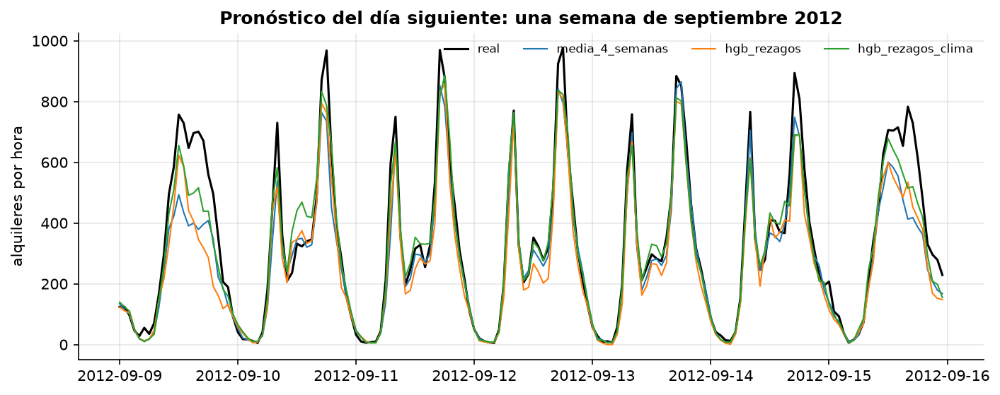
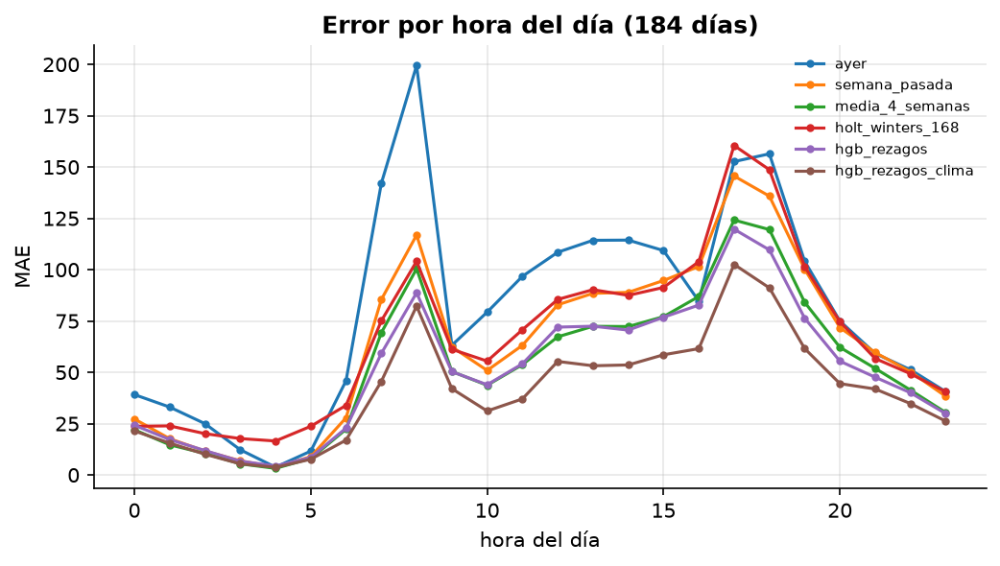

# Mini-proyecto: pronóstico del día siguiente de alquileres de bicicletas

**Pregunta:** cada medianoche, ¿cuántas bicicletas se alquilarán en cada hora del día siguiente?
¿Cuánto mejora un modelo de ML sobre baselines estacionales bien elegidos, y de dónde sale la mejora?

**Datos:** UCI Bike Sharing (Capital Bikeshare, Washington D.C.), alquileres por hora 2011–2012
con calendario y clima. Licencia CC BY 4.0.

## Ejecutar

```bash
uv run python 01-semestre-1/06-electiva-1/a-series-de-tiempo/data/download.py
uv run python 01-semestre-1/06-electiva-1/a-series-de-tiempo/proyecto/run.py   # ~25 s
```

## Preparación de los datos

El archivo **omite las horas sin alquileres** (faltan 165 horas; el mínimo registrado es 1, nunca 0).
Hay dos tipos de huecos:

| Tipo | Ejemplo | Tratamiento |
|---|---|---|
| Horas sueltas de madrugada | 3–4 a. m. | 0 alquileres, de verdad |
| Bloques largos (≥ 6 h, 89 horas en total) | 29–30 oct. 2012 (huracán Sandy, 36 h), 26–27 ene. 2011 (tormenta de nieve), 27–28 ago. 2011 (huracán Irene) | 0 alquileres, marcados como `cierre` |

Las horas de `cierre` no se usan para entrenar ni para medir el error: ningún modelo basado en la
historia puede anticipar que se cierre el sistema por un huracán. (Ver `applied_ts.bikes`.)

## Diseño de la evaluación

- **184 orígenes**: cada medianoche entre el 1 de julio y el 31 de diciembre de 2012, pronóstico
  de las 24 horas siguientes, solo con datos anteriores al origen.
- **Estrategia directa**: todos los rezagos del modelo de ML son ≥ 24 h, así que un único modelo
  puede predecir cualquier hora del día siguiente con información disponible a medianoche
  (notebook 03 compara con la estrategia recursiva).
- Gradient boosting se reentrena al comienzo de cada mes con toda la historia disponible.
- MASE escalado por el MAE in-sample del naive semanal (hasta junio 2012).

## Resultados (184 días, 4 380 horas evaluadas)

| Modelo | MAE | RMSE | MASE | Segundos |
|---|---|---|---|---|
| `hgb_rezagos_clima` (clima **observado**) | **41.9** | 66.9 | 0.875 | 8.3 |
| `hgb_rezagos` | 51.9 | 82.7 | 1.086 | 7.8 |
| `media_4_semanas` (misma hora-semana, últimas 4) | 53.9 | 93.5 | 1.128 | 0.0 |
| `semana_pasada` (seasonal naive 168 h) | 64.3 | 110.5 | 1.344 | 0.0 |
| `holt_winters_168` (propio) | 67.4 | 102.1 | 1.410 | 2.3 |
| `ayer` (seasonal naive 24 h) | 80.1 | 133.9 | 1.675 | 0.0 |

Comparación pareada por día contra el mejor baseline (`media_4_semanas`), con IC bootstrap del
95 % para la diferencia media de MAE diario:

| Modelo | Días en que gana | ΔMAE medio | IC 95 % |
|---|---|---|---|
| `hgb_rezagos` | 47 % | −2.4 | [−6.6, +1.5] |
| `hgb_rezagos_clima` | 59 % | **−12.6** | [−17.1, −8.5] |




## Lectura

- **Con solo la historia, gradient boosting no supera con claridad a promediar las últimas 4
  semanas**: el IC de la diferencia incluye el 0 y gana en menos de la mitad de los días. Un
  baseline estacional robusto ya captura casi todo lo que la historia puede decir.
- **El motor de la demanda es el clima.** Con el clima observado del día el error baja 12.6 en
  promedio (y ese IC no toca el 0). Pero es una **cota superior**: a medianoche no se conoce el
  clima real del día siguiente, solo su pronóstico. En producción, la mejora real dependerá de la
  calidad del pronóstico meteorológico.
- **“Ayer” es el peor baseline**: confunde días laborables con fines de semana. La estacionalidad
  semanal importa más que la diaria.
- **Holt–Winters no encaja bien con esta serie**: con 168 estados estacionales, 8 semanas de
  historia y choques diarios de clima, sus parámetros terminan en los bordes (α ≈ 1, γ ∈ {0, 1}) y
  apenas puede hacer más que seguir el último nivel. statsmodels obtiene un resultado similar en
  los mismos orígenes (ver “Lo que corregí”).
- **El error se concentra en las horas pico** (8 h y 17–18 h), donde la variabilidad absoluta es mayor.

## Lo que corregí al construirlo

Holt–Winters propio empezó con MAE 82, **peor que repetir la semana pasada**. Comparado con
statsmodels en los mismos orígenes (90.6 frente a 71.8), el problema era mío: inicializaba los 168
índices estacionales con *una sola* semana, muy ruidosa, y el optimizador llevaba γ al borde (γ = 1)
para sobrescribirla. Promediando los primeros 4 ciclos para inicializar, el MAE bajó a 67.

## Tu turno

`prediction_interval()` en `run.py` está sin implementar; mientras tanto, la evaluación de
intervalos se omite. Recibe los residuos (real − pronóstico) de los días ya pronosticados, una
columna por hora, y debe devolver los desplazamientos inferior y superior para un intervalo del 80 %.
El script mide la **cobertura empírica** y el ancho medio. Decisiones:

- ¿Cuantiles empíricos por hora (24 intervalos distintos) o un solo cuantil global?
- ¿Todos los residuos pasados o solo una ventana reciente (la demanda cambia con la estación)?
- ¿Simétrico o asimétrico? La demanda no puede ser negativa y los errores grandes son hacia abajo
  (días de lluvia).

Meta: cobertura cercana al 80 % con el menor ancho posible.
