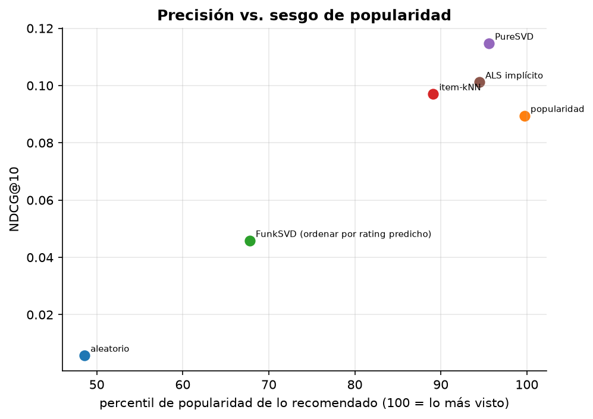
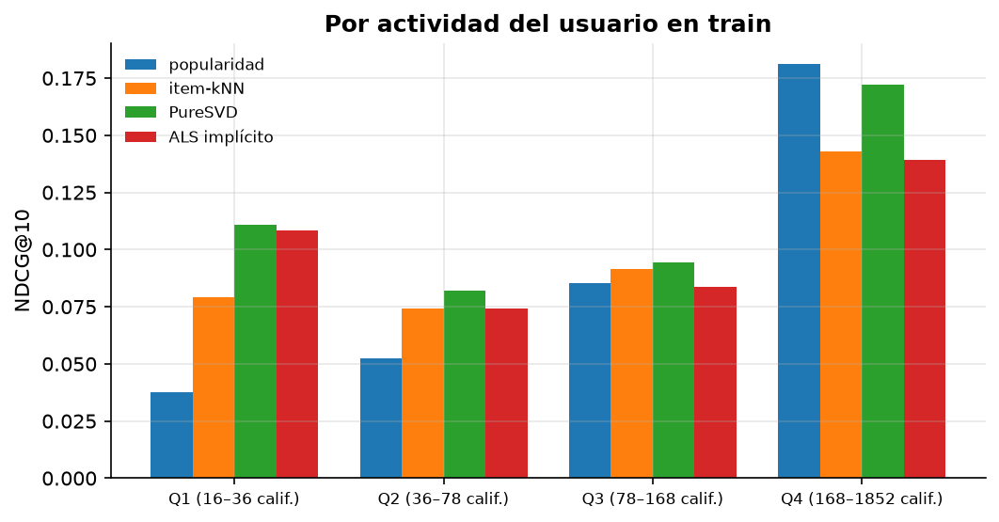

# Mini-proyecto: recomendador de películas sobre MovieLens 1M

**Pregunta:** ¿qué modelo recomienda mejor, cómo se mide “mejor”, y qué cuesta cada mejora en
diversidad?

**Datos:** MovieLens 1M (GroupLens, Universidad de Minnesota): 1 000 209 calificaciones de 6 040 usuarios
sobre 3 706 películas, 2000–2003. Uso no comercial y educativo; los datos **no se redistribuyen** (el
script los descarga). Cita: F. M. Harper, J. A. Konstan, “The MovieLens Datasets: History and Context”,
*ACM TiiS* 5(4), 2015. Este trabajo no está respaldado por la Universidad de Minnesota ni por GroupLens.

## Ejecutar

```bash
uv run python 01-semestre-1/06-electiva-1/b-sistemas-de-recomendacion/data/download.py
uv run python 01-semestre-1/06-electiva-1/b-sistemas-de-recomendacion/proyecto/run.py   # ~2 min
```

## Diseño

- **Partición temporal por usuario:** el 20 % más reciente de cada usuario va a test (197 602
  calificaciones). Un corte temporal global no sirve aquí: el 90 % de las calificaciones son de 2000.
- **Validación temporal dentro del train** (el 10 % más reciente de cada usuario) para elegir *todos*
  los hiperparámetros. El test se usa una sola vez.
- **Dos tareas:** (A) predecir la calificación (RMSE); (B) rankear el top-10, con relevantes = películas
  del test con ≥ 4 estrellas (5 958 usuarios con al menos una).

## A. Predicción de calificaciones

| Modelo | RMSE (partición temporal) |
|---|---|
| media global | 1.148 |
| sesgos μ + b_u + b_i | 0.922 |
| item-kNN (k = 100, λ_denominador = 0.5) | 0.882 |
| ALS explícito (k = 64, λ = 0.1) | 0.885 |
| **FunkSVD (k = 32, 24 épocas)** | **0.874** |

Con partición **aleatoria** (la clásica del premio Netflix) el mismo ALS da 0.863 y los sesgos 0.906:
la temporal es más difícil y más honesta, porque no deja ver calificaciones posteriores del mismo usuario.

## B. Ranking top-10

| Modelo | NDCG@10 | IC 95 % | recall@10 | hit@10 | cobertura | percentil de popularidad |
|---|---|---|---|---|---|---|
| aleatorio | 0.006 | 0.005–0.007 | 0.003 | 0.050 | 1.000 | 48.6 |
| popularidad | 0.089 | 0.086–0.093 | 0.047 | 0.385 | 0.032 | 99.7 |
| FunkSVD (ordenar por rating predicho) | 0.046 | 0.043–0.048 | 0.026 | 0.251 | 0.212 | 67.8 |
| item-kNN (k = 50) | 0.097 | 0.093–0.101 | 0.068 | 0.469 | **0.431** | 89.1 |
| **PureSVD (k = 50)** | **0.115** | 0.111–0.119 | **0.084** | **0.499** | 0.241 | 95.6 |
| ALS implícito (k = 64, α = 0.25) | 0.101 | 0.097–0.105 | 0.080 | 0.474 | 0.331 | 94.5 |

IC 95 % por bootstrap sobre usuarios.



Ejemplo (usuario de actividad mediana). Le gustaron *Full Metal Jacket*, *The Terminator*, *The Matrix*,
*Die Hard* y *The Godfather*; ALS implícito recomienda *Raiders of the Lost Ark*, *Rocky*, *Aliens*, *The
Empire Strikes Back*, *Jaws*, *The Godfather: Part II*, **Predator** (la vio y la calificó ≥ 4 después),
*Ben-Hur*, *In the Line of Fire* y *Mad Max*.

## Lectura

- **El mejor modelo en RMSE es de los peores para rankear en la evaluación offline.** FunkSVD gana la
  tarea A y en la B saca la mitad del NDCG que la popularidad. Es el hallazgo de Cremonesi et al. (2010),
  pero con un matiz que muestra el notebook 03: la evaluación offline premia predecir *qué se va a ver*,
  y FunkSVD predice *cuánto gustaría*. Con datos sintéticos, donde se conoce el gusto real, el orden se
  invierte. Qué importa depende del producto, y solo un experimento A/B lo resuelve.
- **PureSVD gana el ranking**, con un modelo absurdamente simple (SVD de la matriz con ceros), pero
  pagando en diversidad: recomienda lo muy popular (percentil 95.6) y cubre el 24 % del catálogo.
  Item-kNN es el de mejor cobertura (43 %) con un NDCG algo menor.
- **La popularidad es un baseline durísimo:** recomendar lo mismo a todos acierta al menos una película
  para el 38.5 % de los usuarios. Pero cubre el 3 % del catálogo.
- **Por actividad del usuario** (NDCG@10):

  | Usuarios (calificaciones en train) | popularidad | item-kNN | PureSVD | ALS implícito |
  |---|---|---|---|---|
  | Q1 (16–36) | 0.038 | 0.079 | **0.111** | 0.108 |
  | Q2 (36–78) | 0.052 | 0.074 | **0.082** | 0.074 |
  | Q3 (78–168) | 0.085 | 0.091 | **0.095** | 0.084 |
  | Q4 (168–1852) | **0.181** | 0.143 | 0.172 | 0.139 |

  Los modelos aportan más con los usuarios **menos** activos (Q1: casi el triple que la popularidad).
  En Q4 la popularidad obtiene el NDCG más alto, aunque sin intervalos por grupo la diferencia con
  PureSVD no es concluyente. Lo medido: los usuarios de Q4 tienen 10× más relevantes en test (40 frente
  a 4) y sus relevantes son *menos* populares (12 % en el top-100 frente a 28 % en Q1), así que “les
  gusta lo popular” no lo explica. El mecanismo queda abierto (ejercicio 5d).



## Lo que corregí al construirlo

1. **Item-kNN empeoraba al modelo de sesgos** que debía refinar (RMSE 0.765 frente a 0.704 en datos
   sintéticos). Cada par tiene ~3 vecinos calificados y el promedio Σ s·r / Σ|s| dividía por sumas de
   similitud diminutas, amplificando ruido. Sumar λ al denominador (encoger hacia los sesgos) lo resolvió.
2. **Dos hiperparámetros quedaron en el borde de su grilla** (α de ALS implícito y k de item-kNN):
   ampliadas las grillas, los óptimos quedaron en el interior (α = 0.25, k = 50).

## Tu turno

`diversify()` en `run.py` está sin implementar. Recibe los puntajes de ALS implícito para un lote de
usuarios y la popularidad de cada película, y devuelve puntajes reajustados. El script agrega la
variante a la tabla y la figura: cuánto NDCG se pierde a cambio de cuánta cobertura y novedad.

- ¿Penalizar la popularidad de forma lineal, logarítmica, o reordenar por rangos?
- ¿Una sola intensidad para todos, o menos penalización para usuarios con pocos datos (Q1), donde el
  modelo ya es mucho mejor que la popularidad?
- Meta orientativa: duplicar la cobertura (≈ 0.66) perdiendo menos del 10 % de NDCG.
