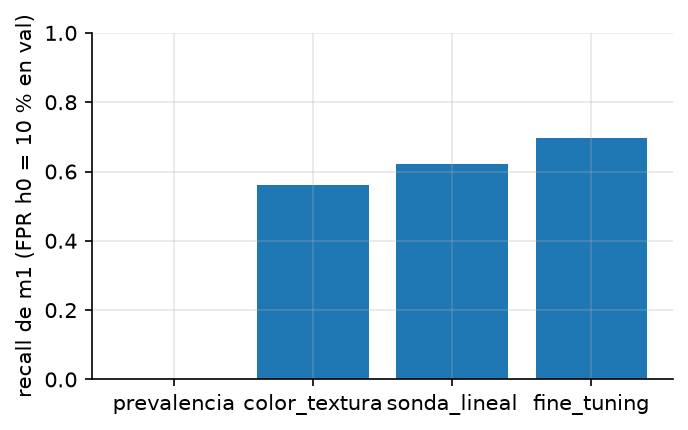
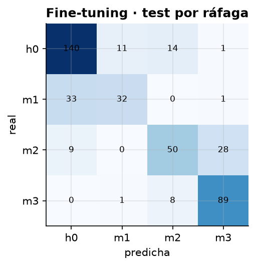
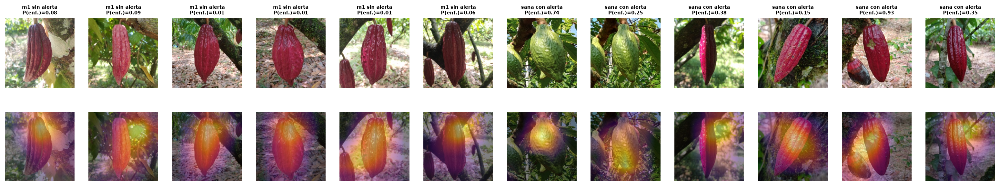
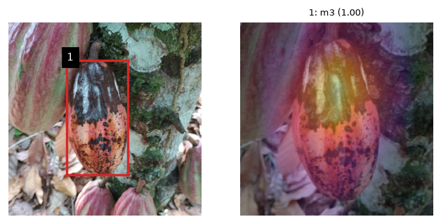

# Mini-proyecto: detección temprana de monilia en mazorcas de cacao

La moniliasis (*Moniliophthora roreri*) es la enfermedad que más pérdidas causa en el cacao
colombiano (30–40 % de la cosecha). La etapa que sirve detectar es la primera, **m1 («jorobas»)**,
cuando la mazorca aún se ve casi sana y retirarla evita que esporule y contagie al resto del lote.

**Pregunta:** ¿se distingue una mazorca en etapa temprana (m1) de una sana, y cuánto de ese acierto es
diagnóstico real y no un atajo (fotos repetidas, el celular con que se tomó la foto)?

**Sistema:** foto → detector de mazorcas (Faster R-CNN MobileNetV3-FPN, una clase) → recorte →
clasificador de etapa (h0 sana, m1 jorobas, m2 manchas café, m3 esporulación).

Todas las cifras salen de [`resultados/metrics.json`](resultados/metrics.json) (una ejecución de
`run.py`, 15 min en un Mac M4 con MPS).

## Datos

**CocoaMoniliaDataSet v2**: Zenodo [10.5281/zenodo.17716661](https://doi.org/10.5281/zenodo.17716661),
licencia CC BY 4.0. Artículo: *Data in Brief* (2025),
[10.1016/j.dib.2025.112447](https://doi.org/10.1016/j.dib.2025.112447). Fotos de celular de dos
fincas (Barrancabermeja, Santander y San Luis, Antioquia).

| | |
|---|---|
| Fotos únicas | 1 913 (40 están en dos carpetas; se cuentan una vez) |
| Mazorcas | 2 120: h0 747 · m1 436 · m2 397 · m3 493 |
| Excluidas del clasificador | 38 `m4` (categoría no documentada) y 9 «conflicto» (la misma mazorca con otra etapa en otra carpeta); el detector sí las usa |
| Otra foto con el mismo nombre | 1 (`IMG_20240802_130325.jpg`: sus cajas de la otra carpeta se ignoran) |
| Orientación EXIF | 1 611 fotos giradas (6: 1 594 · 3: 10 · 8: 7); las cajas están en la foto ya girada |
| Ráfagas | 355 |

Al preparar los datos aparecieron tres problemas que, sin corregirlos, contaminaban los resultados:

1. **Las cajas se anotaron sobre la foto girada según EXIF.** Sin aplicar EXIF, las mazorcas de 1 611
   fotos quedan fuera de su caja. Se verificó con un mosaico antes de entrenar.
2. **Las 232 fotos con nombre epoch caen todas en 2 segundos** (8 ms de mediana entre fotos): es la
   hora de exportación, no la de captura. Tratadas como una sola ráfaga, las 232 iban a test y
   hacían imposible responder H3. Ahora cada una es su propia ráfaga: solo un par tiene correlación
   de miniaturas > 0,9, así que no son una secuencia de la misma mazorca.
3. **Etiquetas en conflicto entre carpetas** (p. ej. m1 en una y m2 en otra): se marcan y se excluyen
   del clasificador, en vez de decidir por el orden de las carpetas.

### Clase confundida con el celular

El formato del nombre de archivo delata el celular, y el celular está muy asociado a la clase (ver la
tabla de la [especificación](../../../docs/superpowers/specs/2026-10-15-vision-cacao-monilia-design.md),
§2.1): las fotos epoch son casi todas h0 y las `AAAAMMDD_HHMMSS` casi todas m1. Un modelo podría
separar h0 de m1 reconociendo el celular. Por eso hay tres particiones:

| Partición | Qué mide |
|---|---|
| **Por ráfaga** (principal) | 70/10/20 agrupada por ráfaga (fotos del mismo celular a ≤ 120 s): ninguna sesión frente a la misma mazorca queda a ambos lados. Resultó 1 284 / 248 / 381 fotos |
| **Publicada** | Las listas `train/val/test.txt` del autor. 11 fotos aparecen en dos partes a la vez (en dos carpetas): se excluyen |
| **Control de celular** | El mismo modelo evaluado solo en fotos `IMG_…`, el único formato con h0 y m1 en cantidad |

## Clasificación de etapa (partición por ráfaga)

Métrica central: **recall de m1** con el umbral que deja un 10 % de falsas alarmas en las sanas de
validación, con puntaje P(enferma) = 1 − P(h0). Test: 166 h0, 66 m1, 87 m2, 98 m3.

| Modelo | Recall m1 | FPR h0 en test | F1-macro |
|---|---|---|---|
| Prevalencia (piso) | 0,000 | 0,000 | 0,142 |
| Color + textura (HSV + LBP + logística) | 0,561 | 0,283 | 0,476 |
| ResNet-18 ImageNet, sonda lineal | 0,621 | 0,223 | 0,702 |
| ResNet-18 ImageNet, fine-tuning | 0,697 | 0,259 | 0,709 |

 

- **La FPR prometida no se cumple en test.** El umbral se fija para 10 % en validación, pero en test
  las falsas alarmas en sanas son del 22–28 %. Las 131 sanas de validación vienen de **solo 4
  ráfagas**: 131 mazorcas parecen muchas, pero son 4 sesiones de fotos. Calibrar un umbral exige
  muchas ráfagas, no muchas mazorcas. No se cambió la partición después de ver test (sería ajustar el
  método al resultado).
- **El error dominante es m1 → h0.** El fine-tuning confunde 33 de las 66 m1 con sanas (argmax); al
  umbral, recupera el 70 %. Entre m2 y m3 hay 28 m2 tomadas por m3: etapas vecinas.
- **Fine-tuning y sonda lineal quedan casi empatados en F1-macro** (0,709 frente a 0,702). Con 1 405
  mazorcas de entrenamiento, ajustar toda la red aporta poco sobre reutilizar los rasgos de
  ImageNet.

Errores críticos con Grad-CAM (m1 sin alerta y sanas con alerta):



Las m1 que se escapan son mazorcas rojas con jorobas sutiles. Varias falsas alarmas son mazorcas
sanas verdes y muy rugosas, una textura que se parece a las jorobas. En dos casos el mapa se enciende
sobre el fondo y no sobre la mazorca.

### Partición publicada y control de celular

| | Recall m1 | FPR h0 | F1-macro | Test (h0 / m1 / m2 / m3) |
|---|---|---|---|---|
| Fine-tuning, partición publicada | 0,756 | 0,105 | 0,867 | 76 / 41 / 36 / 50 |
| Fine-tuning, partición por ráfaga | 0,697 | 0,259 | 0,709 | 166 / 66 / 87 / 98 |
| Fine-tuning por ráfaga, solo fotos `IMG_…` | 0,700 | 0,345 | — | 116 h0 / 60 m1 |

La partición publicada da un F1-macro 0,16 más alto: fotos casi iguales de la misma sesión caen a
ambos lados. Dentro de un solo formato de celular (`IMG_…`), el recall de m1 se mantiene (0,70) pero
las falsas alarmas suben al 34 %.

**Sonda de celular:** con rasgos de ImageNet, una logística distingue dentro de las sanas una foto
`IMG_…` de una epoch con exactitud balanceada **0,763** (473 frente a 249 mazorcas, validación cruzada
agrupada por ráfaga). La señal del celular, o de lo que viene con él (día, finca, luz), está en la
imagen y un modelo la puede usar.

## Hipótesis

Declaradas antes de ver test. Bootstrap por ráfaga (2 000 réplicas), IC 95 % y corrección de Holm
sobre las tres. «Se apoya» = se rechaza H0 **y** la diferencia va en la dirección prevista.

| | Hipótesis | Δ | IC 95 % | p | p Holm | ¿Se apoya? |
|---|---|---|---|---|---|---|
| H1 | Fine-tuning > color + textura en recall de m1 (pareado) | +0,136 | [0,000, +0,433] | 0,054 | 0,054 | No |
| H2 | F1-macro publicada − F1-macro por ráfaga > 0 | +0,158 | [+0,044, +0,266] | 0,001 | 0,002 | **Sí** |
| H3 | Dentro de h0, la sonda predice el celular (exactitud balanceada − 0,5 > 0) | +0,263 | [+0,217, +0,328] | 0,0005 | 0,0015 | **Sí** |

- **H1 no se apoya.** El fine-tuning recupera 13,6 puntos más de m1 que el baseline de color y
  textura, pero con 66 m1 de 15 ráfagas el intervalo toca el 0. La ventaja más clara de la CNN está en
  el F1-macro (0,709 frente a 0,476), es decir, en separar las cuatro etapas, no en la alerta temprana.
- **H2 se apoya:** la partición publicada sobrestima el desempeño. Nota: los dos conjuntos de test
  comparten fotos y el bootstrap no pareado los trata como independientes, así que el IC es
  aproximado.
- **H3 se apoya:** el celular deja huella en la imagen. Las cifras que no controlan el celular pueden
  incluir algo de atajo.

## Detector y sistema completo

| Detector (381 fotos de test) | |
|---|---|
| AP50 | 0,959 |
| AP50:95 | 0,891 |

Sistema completo sobre las fotos de test. Se considera que una mazorca recibe alerta si alguna caja
predicha (puntaje ≥ 0,5) tiene IoU ≥ 0,5 con ella y su recorte supera el umbral:

| | |
|---|---|
| Recall de m1 | 0,727 |
| FPR en h0 | 0,217 |
| Mazorcas detectadas: h0 · m1 · m2 · m3 | 0,916 · 1,000 · 0,954 · 0,969 |

El detector encuentra todas las m1. El cuello de botella es el clasificador, no la localización.

Demo (`diagnosticar.py` sobre una foto de test por ráfaga): la mazorca central, con esporulación, se
detecta y se clasifica m3 con alerta; las tres sanas cortadas por el borde de la foto no se detectan
con puntaje ≥ 0,5.



## Contexto y limitaciones

- El repo del autor reporta mAP50 0,91 con YOLO11l. No es comparable: es otra métrica (detección de 4
  clases), otra tarea y una partición no documentada. Aquí el AP50 es de una sola clase, «mazorca».
- Dos fincas y 9 días: no se valida en fincas nuevas.
- El celular está confundido con la clase y solo se controla en parte (H3 muestra que es detectable).
- m1 es una etapa visual (jorobas), sin confirmación de laboratorio.
- El umbral se calibró con pocas ráfagas de sanas (ver arriba).

## Uso

```bash
uv sync --extra base --extra dl
uv run python 02-semestre-2/01-vision-por-computador/data/download.py   # 6,2 GB; MD5 y SHA-256
uv run python 02-semestre-2/01-vision-por-computador/proyecto/run.py    # ~15 min en M4 (MPS)
uv run python 02-semestre-2/01-vision-por-computador/proyecto/diagnosticar.py foto.jpg
```

Zenodo limita cada conexión a unos 400 KB/s, así que la descarga tarda horas. Si ya tienes el zip,
déjalo en `data/` y `download.py` lo verifica por MD5 y sigue.

**Tu turno:** la aumentación del clasificador (`train_augmentation` en
`src/applied_cv/cocoa/classifiers.py`) es la versión mínima (solo volteo horizontal). Estos resultados
usan esa versión.
