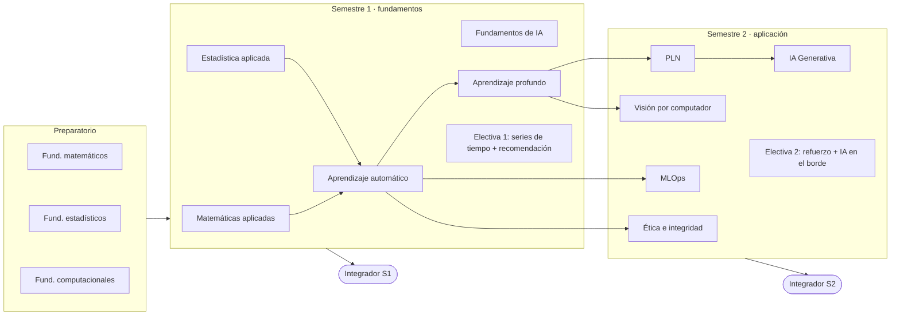

# Especialización en IA — recorrido práctico

[](https://github.com/serandmoncas/especializacion-ia/actions/workflows/ci.yml)

Repositorio de estudio que recorre la malla de una Especialización en IA de 24 créditos
(2 semestres, estructura tipo EAFIT) más un preparatorio de nivelación. Cada curso es un
módulo con notebooks ejecutables, ejercicios con soluciones y un mini-proyecto; cada
semestre cierra con un proyecto integrador.

Principio rector: **implementar desde cero, luego comparar con la librería.**
Contexto y decisiones de diseño en [`HANDOFF.md`](HANDOFF.md).

## Mapa de la malla



## Progreso

Leyenda: ✅ terminado · 🚧 en curso · ⬜ por iniciar. Detalle por módulo en su README
(definición de terminado: README · ≥ 2 notebooks · ejercicios + soluciones · mini-proyecto · tests · CI).

| Bloque | Módulo | Cr. | Tipo | Mini-proyecto | Estado |
|---|---|---|---|---|---|
| Prep. | [Fundamentos Matemáticos](00-preparatorio/01-fundamentos-matematicos) | — | Nivelación | Derivadas numéricas y Taylor | ⬜ |
| Prep. | [Fundamentos Estadísticos](00-preparatorio/02-fundamentos-estadisticos) | — | Nivelación | TLC por Monte Carlo | ⬜ |
| Prep. | [Fundamentos Computacionales](00-preparatorio/03-fundamentos-computacionales) | — | Nivelación | EDA vectorizado con pandas | ⬜ |
| S1 | [Matemáticas aplicadas](01-semestre-1/01-matematicas-aplicadas) | 2 | Compartida | Regresión lineal y GD desde cero | ✅ |
| S1 | [Estadística aplicada](01-semestre-1/02-estadistica-aplicada) | 2 | Compartida | A/B/C test de email (Hillstrom) | ✅ |
| S1 | [Fundamentos de IA](01-semestre-1/03-fundamentos-ia) | 2 | Núcleo | Pathfinding A*/ALT en mapas reales | ✅ |
| S1 | [Aprendizaje automático](01-semestre-1/04-aprendizaje-automatico) | 2 | Compartida | Pipeline completo sobre UCI Adult | ✅ |
| S1 | [Aprendizaje profundo](01-semestre-1/05-aprendizaje-profundo) | 2 | Compartida | CNN en Fashion-MNIST vs. baselines | ✅ |
| S1 | [Electiva 1 · Series de tiempo](01-semestre-1/06-electiva-1/a-series-de-tiempo) | 2 | Electiva | Pronóstico de demanda con backtesting | ✅ |
| S1 | [Electiva 1 · Sistemas de recomendación](01-semestre-1/06-electiva-1/b-sistemas-de-recomendacion) | (2) | Electiva | Recomendador de películas (MovieLens 1M) | ✅ |
| S1 | [Proyecto integrador S1](01-semestre-1/proyecto-integrador-s1) | — | — | Temas de libros como puente para recomendar (goodbooks-10k) | 🚧 |
| S2 | [Visión por computador](02-semestre-2/01-vision-por-computador) | 2 | Propia | Transfer learning | ⬜ |
| S2 | [PLN](02-semestre-2/02-pln) | 2 | Propia | Clasificador de texto en español | ⬜ |
| S2 | [IA Generativa](02-semestre-2/03-ia-generativa) | 2 | Propia | RAG con evaluación | ⬜ |
| S2 | [MLOps](02-semestre-2/04-mlops) | 2 | Compartida | FastAPI + Docker + MLflow + CI | ⬜ |
| S2 | [Ética e integridad de datos](02-semestre-2/05-etica-e-integridad-datos) | 2 | Propia | Auditoría de sesgo | ⬜ |
| S2 | [Electiva 2 · Aprendizaje por refuerzo](02-semestre-2/06-electiva-2/a-aprendizaje-por-refuerzo) | 2 | Electiva | Agente de control | ⬜ |
| S2 | [Electiva 2 · IA en el borde](02-semestre-2/06-electiva-2/b-ia-en-el-borde) | (2) | Electiva | Compresión y latencia de un modelo | ⬜ |
| S2 | [Proyecto integrador S2](02-semestre-2/proyecto-integrador-s2) | — | — | App de IA desplegada | ⬜ |

## Puesta en marcha

Requiere [uv](https://docs.astral.sh/uv/). Python 3.12 se instala solo.

```bash
uv sync --extra base                    # núcleo: numpy, pandas, scipy, sklearn, matplotlib
uv sync --extra base --extra dl         # + torch (aprendizaje profundo, visión)
uv sync --all-extras                    # todo: + transformers, anthropic, mlflow, fastapi
uv run jupyter lab
```

| Extra | Para | Paquetes |
|---|---|---|
| `base` | Preparatorio, S1 | numpy, pandas, scipy, matplotlib, scikit-learn |
| `dl` | Aprendizaje profundo, visión | torch, torchvision |
| `nlp` | PLN, IA generativa | transformers, datasets, sentence-transformers, anthropic |
| `mlops` | MLOps, integrador S2 | mlflow, fastapi, uvicorn |

Herramientas de desarrollo (ruff, pytest, jupyterlab, nbclient) van en el grupo `dev`,
que uv instala por defecto.

## Comandos

```bash
uv run ruff check --fix && uv run ruff format   # lint + formato (incluye notebooks)
uv run pytest                                   # tests de common/ y de todos los módulos
uv run python scripts/run_notebooks.py          # ejecuta notebooks marcados como smoke
uv run python scripts/run_notebooks.py --all    # ejecuta todos los notebooks
```

## Estructura

```
common/                 # set_seed, rutas de datos, estilo de gráficos (`import common`)
scripts/                # utilidades del repo (ejecutor de notebooks)
tests/                  # tests de common/
00-preparatorio/        # 3 módulos de nivelación
01-semestre-1/          # 6 módulos + proyecto integrador
02-semestre-2/          # 6 módulos + proyecto integrador
```

Cada módulo:

```
NN-nombre/
├── README.md           # objetivos, temas, recursos, checklist
├── notebooks/          # metadata "smoke": true → se ejecuta en CI
├── src/<paquete>/      # código reutilizable, importable tras `uv sync`
├── tests/
├── ejercicios/         # enunciados + stubs; soluciones/ aparte
├── data/               # ignorada por git, salvo download.py
└── proyecto/           # mini-proyecto: README, código, resultados/
```

El código de cada módulo es un paquete con nombre en inglés (p. ej. `applied_math`)
registrado en `[tool.hatch.build.targets.wheel].packages` de `pyproject.toml`.
Así notebooks, tests y proyecto lo importan igual, sin manipular `sys.path`.

## Notas

- Contenido original: no replica material con derechos de autor de EAFIT.
- Licencia: [MIT](LICENSE). Los datasets conservan las licencias de sus fuentes (ver cada `data/download.py`).
- Los datos y pesos de modelos nunca se suben; cada módulo trae `data/download.py`.
